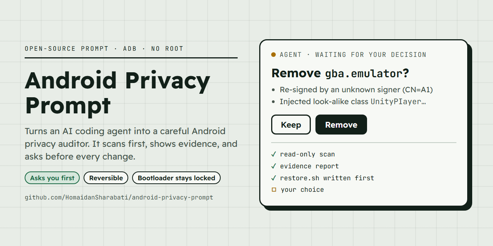
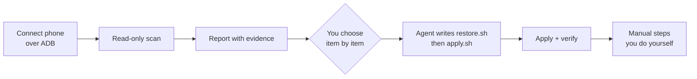

<div align="center">



**This prompt turns an AI coding agent into a careful Android privacy auditor.**
It works over ADB, needs no root, and the agent asks you before every change.


[**prompt.txt**](prompt.txt) (English) · [**prompt-ar.txt**](prompt-ar.txt) (العربية)

</div>

---

## Why this exists

I asked an AI agent to scan my phone for spyware and clean it up. Two things went wrong:

1. **It nearly removed apps I had built myself.** It flagged them as "unknown" just because they were sideloaded.
2. **It missed a real problem.** A cracked emulator, re-signed by an anonymous signer, slipped through.

So I wrote a prompt that keeps the power of an agent with ADB and adds firm rules:

- **Scan first.** The agent changes nothing during the scan.
- **Show evidence.** Every finding comes with proof.
- **Ask before every change, one item at a time.** "Yes" means only the items you picked, never "do everything".

## How it works



## Quick start

1. **On the phone:** enable *Developer options*, then *USB debugging*. Connect it to your computer and accept the prompt on the phone screen.
2. **On the computer:** install [Android platform-tools](https://developer.android.com/tools/releases/platform-tools) (for `adb`) and open an AI agent that can run shell commands, such as [Claude Code](https://claude.com/claude-code).
3. **Paste the contents of [`prompt.txt`](prompt.txt)** into the agent. Keep the phone unlocked when the agent asks to read a screen.

The prompt was written and tested on a **Samsung Galaxy** with One UI. The scan works on any modern Android phone. The debloat list is Samsung-specific.

## What the agent checks

| Check | What it catches |
|---|---|
| Boot state, SELinux, `su`, Knox flag | Rooted or tampered system |
| Accessibility services, notification listeners, device admins | Apps that can read your screen or messages |
| VPN, proxy, Private DNS, mock location | Traffic being redirected |
| User CA certificates, in every profile | Interception of encrypted traffic |
| Sideloaded apps + APK signatures | Cracked or re-signed copies, injected look-alike classes, mining strings |
| Apps with no launcher icon | Hidden apps |
| Granted runtime permissions | Over-permissioned apps |
| **7-day access history** (`appops`) | Who really used the camera, mic, location, contacts, call log, SMS or clipboard, and whether in the background |
| CPU, temperature, per-app network upload | Miners and data exfiltration |
| Known bad preloads (e.g. AppCloud) | Partner bloatware that collects data |
| Battery health | A worn battery that explains fast drain |

## What it can change (only the items you approve)

| Item | Effect | Undo |
|---|---|---|
| Private DNS (AdGuard, Quad9, Cloudflare, Mullvad) | Encrypted DNS. AdGuard also blocks ads and trackers for every app. | Turn it off |
| Diagnostics off | Stops Samsung error logs, Samsung security reports and Google APK uploads. Play Protect keeps scanning. | `restore.sh` |
| Background scanning off | No Wi-Fi or Bluetooth scanning while those radios are off | `restore.sh` |
| Revoke specific permissions | Only where the access history shows misuse | `pm grant` |
| Restrict background running | For ad-heavy apps you decide to keep | `appops ... allow` |
| Remove preloads | Telemetry, partner stubs, and unused features you confirm | `install-existing` |
| Faster animations | 0.5x | `restore.sh` |
| Delete third-party apps | One app at a time, each with its reason | Reinstall |

## What it will never do

- Root the phone, unlock the bootloader, or touch Knox or the warranty.
- Disable Play Protect or system updates.
- Touch the Secure Folder, banking or government apps, or authenticators.
- Remove an app you said to keep, or ask about it again.
- Press an irreversible button (such as *Delete advertising ID*) for you without your explicit confirmation.
- Send anything from your phone to an outside service.
- Promise "100% secure" or make up speed numbers.

## Example run

The test device was a Galaxy A54 on Android 16 / One UI 8.5.

**Clean:**
- Verified boot green, bootloader locked, SELinux enforcing, no root.
- CPU 97% idle.
- No background camera or microphone access in 7 days.
- No planted CA certificates.

**Found:**
- A **cracked game emulator**, re-signed by an anonymous signer, with an injected class named `UnityPIayerNativeActivity` (capital **I** instead of **l**).
- A **messaging app reading the call log in the background**.
- A **social app reading the location stored in photos** in the background.
- **Google Timeline** collecting location.
- The preloaded **AppCloud** (`com.aura.oobe.samsung.gl`).
- Ad-heavy video apps.
- Battery health at **69%**.

**Applied, each item with the owner's approval:**
- AdGuard Private DNS (validated; ad domains blocked).
- Diagnostics and background scanning turned off.
- 7 permissions revoked across 4 apps.
- 21 packages removed (telemetry, partner stubs, unused features) and Timeline disabled.
- 4 apps deleted.
- Advertising ID zeroed.
- Animations set to 0.5x.

| | Before | After |
|---|---|---|
| Security | 8 / 10 | 9 / 10 |
| Privacy | 4 / 10 | 7.5 / 10 |
| Smoothness | 7 / 10 | 8 / 10 |

<sub>These ratings are estimates, not benchmarks. On a stock phone with Google services and no root, about 8.5 / 10 is the realistic privacy ceiling.</sub>

## Undo everything

Before changing anything, the agent writes `restore.sh` with your phone's **original** values. To roll back:

```bash
adb push restore.sh /data/local/tmp/
adb shell sh /data/local/tmp/restore.sh
```

To bring back a single removed package:

```bash
adb shell cmd package install-existing --user 0 <package>
```

## Honest limits

- **Nothing makes a phone 100% private.** Google and Samsung core services, your accounts, and the apps you choose still exchange data.
- `pm uninstall --user 0` hides a preload from you. The package still sits on the system partition. **A factory reset or a major OS update can bring it back.** Run the prompt again after either one.
- ADB cannot see inside the Secure Folder.
- The DNS provider you pick sees which domains you look up. Pick one whose logging policy you trust.

## About AppCloud

AppCloud is part of ironSource's Aura platform. It ships preloaded on some Galaxy A, M and F phones in West Asia and North Africa. In 2025, the digital-rights group SMEX raised concerns about:
- its data collection,
- how hard it is to remove,
- its lack of an accessible privacy policy.

Samsung says its own privacy policy covers the app. No public technical evidence of misuse has been published. The prompt removes AppCloud only if you approve.
Sources: [SMEX](https://smex.org/?p=34745) · [Malwarebytes](https://www.malwarebytes.com/blog/news/2025/11/budget-samsung-phones-shipped-with-unremovable-spyware-say-researchers) · [Android Authority](https://www.androidauthority.com/samsung-appcloud-spyware-controversy-3616325/)

## Files

| File | |
|---|---|
| [`prompt.txt`](prompt.txt) | The prompt, in English |
| [`prompt-ar.txt`](prompt-ar.txt) | The same prompt in Arabic |

## Disclaimer

You run this on your own device at your own risk. Read the agent's plan before you approve it. Not affiliated with Samsung, Google, or Anthropic.

## License

[MIT](LICENSE)
